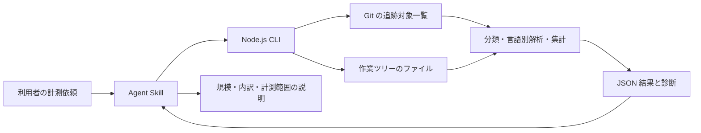

# miku-repo-scale：Node.js によるソフトウェア規模計測スキルの初期設計

2026-11-05。状態：設計案。runtime と installable skill は未実装。

実装作業は [Node.js 初期版の実装計画](miku-repo-scale-node-implementation.md) の RSC-00〜15 に分解した。

利用者の依頼は「ソフトウェア規模を測るスキルを設計する。初期版の実現スクリプトは Node.js 限定でよい。計測対象は複数言語」である。この文書では、実行環境を Node.js に固定し、対象言語とは独立に扱う。

追加の設計方針として、生成 AI の動作を決める Markdown の指示、JSON/YAML の定義、JavaScript/Python 等の実装を、ソフトウェアの構成ソースとして扱う。プログラミング言語のコード行数に加えて、指示・実装・定義の規模を計測する。

既存の [親 Issue #72](https://github.com/igapyon/igapyon-agent-skills/issues/72)、[収集・分類 #319](https://github.com/igapyon/igapyon-agent-skills/issues/319)、[行数・コメント解析 #321](https://github.com/igapyon/igapyon-agent-skills/issues/321)、[Agent Skill #322](https://github.com/igapyon/igapyon-agent-skills/issues/322) を具体化する。Issue 本文はこの設計作業では更新していない。

## 1. 何を得られるスキルにするか

Git リポジトリを指定すると、その作業ツリーについて、次を返す。

- 全体のファイル数・バイト数・物理行数。
- 本体、テスト、文書、設定、生成物、その他の内訳。
- 言語別のファイル数・物理行数・コード行数・コメント行数。
- Markdown・JSON・YAML を含む、動作を決めるソースの指示・実装・定義別の規模。
- 計測できた範囲と、未対応・除外・読み取り失敗の内訳。

生成 AI の開発資産として重視する初期対応拡張子は、`.md`、`.mjs`、`.json`、`.yml`、`.yaml`、`.js`、`.ts`、`.py` とする。JSON はファイル数・bytes・物理行数・非空白行数、TypeScript はそれらに加えてコード・コメント行数まで計測する。関連拡張子と従来言語の対応範囲は節4・節5.2に定める。

本体の規模を尋ねられた場合は `source` を主に示し、テストと生成物を別に表示する。`source` にはプログラム実装だけでなく、役割が確認できる Agent の指示と動作定義も含める。リポジトリ全体の規模を尋ねられた場合は全カテゴリを示す。生成物を含む大量の行数を、手書きの本体コードの規模として説明しない。

行数から品質、生産性、工数、複雑度を推定する機能は初期版に含めない。異なる言語のコード行数は、そのまま同等の機能量を表す指標とは扱わない。

## 2. 実装と配布の境界

| 部分 | 名前 | 所有する責務 |
| --- | --- | --- |
| 製品本体 | `miku-repo-scale` | 対象収集、分類、decode、計数、集計、診断、JSON 契約 |
| 配布用スキル repository | `miku-repo-scale-skills` | runtime の固定・同梱、説明資料、bundle 検査 |
| インストールされるスキル | `igapyon-miku-repo-scale` | 利用者の対象指定を解釈、CLI を実行、結果を説明 |



初期版の製品ソース、adapter、ビルド・検査スクリプトは JavaScript ESM（`.mjs`）で実装する。実行時は Node.js と Git を必要とする。Git は追跡対象の列挙に用い、計数ロジックは Node.js 側に置く。対象の Java、Python 等の処理系、コンパイラ、ビルドツールは不要であり、対象コードを実行しない。

Node.js の最低実行版は 22 を初期案とし、その版で配布済み artifact の動作を確認する。Release build に用いる版は実装開始時に固定する。Node.js で動く字句解析ライブラリを採用する場合は版・ライセンスを固定して runtime に bundle し、利用時の `npm install` を不要にする。外部処理系への委譲や Java 版・Python 版の同時開発は初期版の要件にしない。

Main Application の source repository と固定 release/revision は実装開始時に確定する。新規 repository が既に存在するとは仮定しない。この repository には設計を保存し、runtime の正本をスキル側へ重複実装しない。

## 3. 対象ファイルと読取時点

### 3.1 初期版の入力

`analyze <root>` の `<root>` は Git 作業ツリーのルートとする。省略時は現在位置が属する作業ツリーのルートを使う。明示した path がサブディレクトリなら、暗黙に親全体へ広げず、ルート指定を案内する。部分計測は後述の `--include` で行う。

追跡対象は Git index、計測する内容は現在の作業ツリーから取得する。未 commit の変更や stage 済みの新規ファイルも対象になる。結果の `input.content_source` は `worktree` に固定する。HEAD の内容や index の blob を測った結果とは説明しない。

Git の収集 adapter は `git -C <root> ls-files --cached --stage -z` の出力を NUL 区切りのバイト列として読む。空白・タブ・改行入り path を行分割しない。mode・object ID・stage と path の境界を解析し、同一 path の複数 stage を重複計上しない。これらの出力形式は [git-ls-files 公式仕様](https://git-scm.com/docs/git-ls-files) に基づく。

| 対象 | 初期版の扱い |
| --- | --- |
| 通常の tracked file | 作業ツリーの bytes を読み計測 |
| untracked / ignored のみのファイル | 収集しない。既に tracked のものは ignore 規則で除かない |
| index に残り作業ツリーから削除されたファイル | `FILE_MISSING`。0 bytes として成功扱いしない |
| unmerged path | `UNMERGED_PATH`。各 stage の合算や任意 stage の採用をしない |
| symlink / Windows reparse point | 追跡しない。項目として報告し、リンク先を読まない |
| submodule | gitlink を1項目として報告。内部のファイル数へ換算しない |
| binary | bytes のみ計上。行数は `null` |
| sparse checkout で欠けたファイル | `FILE_MISSING` として計測不足を明示 |
| bare repository / Git repository 外 | hard error |

Git index の symlink mode に加えて実ファイルの種類も調べる。通常ファイルから symlink への置換、親ディレクトリのリンク化、対象ルート外への解決を検出した場合はその path を読まない。Git subprocess は引数配列で起動し、対象内の設定ファイルを JavaScript として実行しない。

path はルート相対、区切りは `/`、大小文字と Unicode 表現は保存する。不正 UTF-8 path は置換して別 path にせず `PATH_ENCODING_UNSUPPORTED` とし、元 bytes の base64 を診断に残す。

読取前後のファイル情報と収集前後の index 一覧を照合する。変化を検出したら `INPUT_CHANGED` とし、結果を完全成功にしない。これは同時書込に対する完全な snapshot 保証ではない。再現比較は静止した同一 bytes・同一設定・同一 runtime/ruleset で行う。

### 3.2 絞り込み

- `--include <glob>` と `--exclude <glob>` は反復可能。
- include 未指定は全 tracked entries、指定時はその和集合。exclude は常に優先。
- glob は `/` 区切り相対 path に対し、大小文字を区別する。`*` は1区間内、`**` は0個以上の区間、`?` は1文字。否定・brace 展開は初期版で扱わない。
- CLI の例では glob を引用符で囲み、shell 展開を防ぐ。
- 除外された entry も path と理由を保持する。集計対象外であることを機械的に区別する。
- 生成物や vendor を暗黙に捨てない。分類し、必要な場合に利用者が除外を指定する。

## 4. 言語識別と用途分類

`language`（言語・形式）、`role`（役割）、`category`（用途区分）を別フィールドにする。たとえば `tests/example.test.ts` は `language: typescript`、`role: implementation`、`category: test`、通常の `SKILL.md` は `language: markdown`、`role: instruction`、`category: source` となる。各軸の分類理由を stable ID で記録する。

言語識別は明示設定、既知の basename、拡張子、拡張子のないファイルの既知 shebang の順で行う。拡張子は大小文字を区別し、未知の拡張子へ内容から言語を推測適用しない。初期の既知 basename は `.bashrc` / `.bash_profile` / `.zshrc` / `.zprofile`。shebang は固定リストの `sh` / `bash` / `zsh` / `python` / `python3` / `node` と、`/usr/bin/env <name>` の単純形を扱う。複雑な shebang は診断して上書き指定へ案内する。

形式 registry には初期版から `markdown`（`.md` / `.markdown`）、`json`（`.json`）、`yaml`（`.yml` / `.yaml`）を含める。`.mjs` / `.js` は `javascript`、`.ts` / `.mts` / `.cts` / `.tsx` は `typescript`、`.py` は `python` に集約するが、拡張子別の集計も保持する。

### 4.1 動作を決めるソースの役割

| role | 意味 | 例 |
| --- | --- | --- |
| `instruction` | Agent に与える指示・ルール・プロンプト | `SKILL.md`、`AGENTS.md`、明示設定した prompt / reference の Markdown |
| `implementation` | プログラムの実装 | `.mjs`、`.js`、`.ts`、`.py`、`.java` 等 |
| `definition` | 動作や接続を宣言する定義 | Agent 設定、workflow、tool schema として指定した `.json` / `.yml` |
| `documentation` | 人間向けの説明・設計資料 | README、一般の説明用 Markdown |
| `data` | 入力・評価例・データ | 明示指定した JSON の入力例や fixture |
| `unknown` | 上記の役割を確定できないもの | 用途が指定されていない JSON / YAML 等 |

役割の優先順は config の明示値、既知の path/basename、プログラミング言語の実装、文書形式の既定値、`unknown` とする。既知規則は `SKILL.md` / `AGENTS.md` を instruction、`**/agents/openai.yaml` と root の `.github/workflows/*.yml` / `*.yaml` を definition とする。後者は通常の開発自動化も含む。JSON/YAML の拡張子だけでは動作定義かデータかを確定しない。通常の `.md` は documentation とし、プロンプトや指示 reference の path は config で指定できる。

これは生成 AI が作成したファイルかどうかの分類ではない。従来のプログラムにも Agent システムにも同じ role を適用し、拡張子を「従来型専用」「生成 AI 専用」に分断しない。自動判定と利用者指定を `role_reason` で区別する。

### 4.2 用途区分

用途の既定優先順位は次とし、最初に一致したものを採用する。role は category を決める前に確定する。

| 順位 | category | 初期 ruleset の例 |
| --- | --- | --- |
| 1 | 利用者の明示値 | 設定の ordered rules に最初に一致するもの |
| 2 | `generated` | root の `dist/**` / `build/**` / `target/**`、`**/*.min.js` / `**/*.map` |
| 3 | `test` | `**/test/**` / `**/tests/**` / `**/__tests__/**`、`**/*.test.*` / `**/*.spec.*` |
| 4 | `source` | `role: instruction` または `definition`。Markdown の指示も本体に含む |
| 5 | `documentation` | root の `docs/**`、`.md` / `.markdown` / `.rst` / `.adoc`、`README` / `LICENSE` とその既知 suffix |
| 6 | `configuration` | `.json` / `.yaml` / `.yml` / `.toml` / `.ini` / `.xml`、`.gitignore` / `.gitattributes` / `.editorconfig` |
| 7 | `source` | `role: implementation` |
| 8 | `other` | 上記に一致しないもの |

これは path に基づく用途分類であり、生成履歴や作者を証明しない。`dist/` に手書きコードがある場合などは明示設定で修正できる。vendor や fixture の自動識別はしない。優先規則の変更は `ruleset_version` を更新する。

設定は `--config <file.json>` で明示指定した JSON だけを読む。`schema_version: miku-repo-scale.config/v1`、ordered `rules` とし、各 rule は `match` と任意の `category` / `role` / `language` / `encoding` を持つ。各属性について最初に値を与えた rule が勝つ。未知の key・role・言語 ID・encoding・不正な glob は設定 error にする。設定ファイルの暗黙探索、外部 plugin の動的 load、実行可能な設定は設けない。

例として、プロンプトと tool 定義を本体、評価データをテストに位置付けられる。

```json
{
  "schema_version": "miku-repo-scale.config/v1",
  "rules": [
    { "match": "prompts/**/*.md", "role": "instruction" },
    { "match": "agent/tools/*.json", "role": "definition" },
    { "match": "evals/**/*.json", "role": "data", "category": "test" }
  ]
}
```

## 5. 計測値の定義

### 5.1 bytes と物理行

`bytes` は読めた通常ファイルの元のバイト数で、BOM・改行を含む。decode 後の文字数とは区別する。binary は bytes に含む。symlink / gitlink の参照先サイズは含めない。

改行は CRLF、LF、単独 CR。CRLF を2行としない。空ファイルは0行、末尾改行の直後に余分な1行を作らない。例：`a` と `a\n` は1行、`\n` は1行、`a\n\n` は2行。先頭 BOM を取り除いた後に数えるため、BOM のみのファイルは0行。

空白行は、改行を除いた内容が空、または space / tab / form feed / vertical tab のみの行。コメントや複数行文字列の途中でも、物理的に空白だけなら空白行を優先する。その他の Unicode 空白や U+2028/U+2029 はこの物理行定義の区切り・空白に加えない。字句解析器には別途、言語仕様上の行終端としての扱いが必要になる。

| field | 意味 |
| --- | --- |
| `total_physical_lines` | 物理行の総数 |
| `blank_lines` | 空白だけの物理行 |
| `nonblank_lines` | 総物理行数 − 空白行数。全 text で計算できる |
| `comment_only_lines` | 空白を除く部分がすべて comment の行 |
| `code_lines` | comment only 以外の非空白行。code / literal と混在行を含む |
| `mixed_code_comment_lines` | code と comment の両方を含む行 |
| `lines_with_comments` | comment only と mixed の合計 |

字句分類に対応したファイルでは、次を必ず満たす。

```text
total_physical_lines = blank_lines + comment_only_lines + code_lines
nonblank_lines = comment_only_lines + code_lines
lines_with_comments = comment_only_lines + mixed_code_comment_lines
0 <= mixed_code_comment_lines <= code_lines
```

`code_lines` は字句上のコメント範囲に基づく物理行の分類である。複数行文字列や heredoc の非空白本文も含み、実行文数を意味しない。本指標で空白としない文字が comment の外にある行も code に分類する。Python の docstring は文字列として code に含む。shebang は code、`# type:` 等の comment 構文に載った指示は comment とする。

### 5.2 初期対応言語と字句解析

| language | 拡張子 | release までに扱う主要構文 |
| --- | --- | --- |
| `java` | `.java` | 行・block comment、string、char、text block、Unicode escape の前処理と元行への対応 |
| `javascript` | `.js` / `.mjs` / `.cjs` / `.jsx` | string、template と式補間、regex と除算の区別、JSX text と埋込式 |
| `typescript` | `.ts` / `.mts` / `.cts` / `.tsx` | JS 相当の字句処理、TS の構文文脈、TSX と型表現の区別 |
| `python` | `.py` | `#`、単・二重・triple quote、raw / bytes / f-string と埋込式 |
| `shell` | `.sh` / `.bash` / `.zsh` | 単・二重 quote、escape、token 境界の `#`、parameter / command substitution、heredoc |

`.jsx` / `.tsx` のモードは拡張子から固定する。Shell と識別済みのファイルでは拡張子があっても shebang を調べ、dialect を決める。`.sh` は既知 shebang の `sh` / `bash` / `zsh` を採用し、shebang がなければ `sh` とする。`.bash` / `.zsh` や既知 basename が示す dialect と shebang が相反した場合は basic metrics と診断を返す。config の明示 language ID は dialect を選べる `shell-sh` / `shell-bash` / `shell-zsh` も受け付け、集計 language は `shell` に統合する。Python 等の対象文法版と対応構文表は、実装時に scanner ごとに固定し、`ruleset_version` とともに記録する。

ファイル全体を行ごとの正規表現だけで処理せず、字句状態を行間で保持する。regex / JSX / template / f-string / heredoc の文脈を解けない共通 scanner で全言語を代用しない。Node.js 上の tokenizer を再利用してもよい。必要な構文解析を内部に用いても、出力指標は物理行のままとする。

重要な実装判断は JS/TS の regex・JSX と Shell の文脈処理である。行数集計を作り込む前に、代表 fixture で tokenizer の適合性と bundle サイズを確認する。言語処理系そのものの起動は採用しない。

対応表外の構文、不正・未完了な構文、解釈が曖昧な入力を検出した場合、そのファイルの comment / code 指標をすべて `null` にして `COMMENT_ANALYSIS_UNSUPPORTED` または `LEXICAL_ERROR` を返す。途中までの推定値を完全な計測値として採用しない。総行数・空白行数・bytes は保持する。未知の言語も同様に basic metrics を返す。

この fallback は release 条件を省略するためのものではない。上表の代表構文が未対応のままなら、その言語の対応完了とは記録しない。C/C++、C#、Go、Rust、SQL、HTML 等は初期版ではコメント解析対象外であり、拡張子 registry を追加しても basic metrics と字句解析対応を別に宣言する。

Markdown・JSON・YAML は初期版で basic metrics に正式対応する。これらの形式と、その instruction / definition を含むソース規模は、ファイル数・bytes・物理行数・非空白行数で表示する。comment / code 分類は初期版の対象外として `comment_analysis: not_requested` を記録し、未対応言語の warning を一律には出さない。プログラミング言語の `available` / `unsupported` / `error` と区別する。

Markdown の見出し・箇条書き・コードブロックも文書の物理行として1回数える。埋込コードを別言語のソースとして重複加算しない。YAML の block scalar 内のプロンプト等も初期版ではファイル単位の role に従う。instruction / definition の非空白行数をコード行数へ改名せず、プログラムの LOC と共通の機能量へ換算しない。

### 5.3 encoding と binary

既定は UTF-8 の厳密 decode。UTF-8 BOM、UTF-16LE/BE BOM は認識する。明示指定時は `utf-8` / `utf-16le` / `utf-16be` を初期対応値とする。優先順位は per-path config、`--encoding`、BOM、UTF-8 default。明示 encoding と BOM が相反したら診断する。

decode に失敗しても置換文字で読み進めない。Node.js の `TextDecoder` の fatal decode に相当する動作を用いる（[公式 API](https://nodejs.org/api/util.html#class-utiltextdecoder)）。Shift_JIS / Windows-31J 等の厳密対応は後続候補とし、初期版では自動推定・変換を行わない。

binary 判定は初期 ruleset に固定した signature（PNG / JPEG / GIF / PDF / ZIP / gzip / ELF / PE 等）を先に確認し、次に BOM または明示 encoding を適用する。UTF-16 として扱う根拠がない入力の NUL byte は binary とする。その他の decode failure は binary と断定しない。判定理由を記録し、encoding の明示指定は binary signature を text として強制読取する機能にはしない。

1ファイルの読取上限は既定 16 MiB、`--max-file-bytes` で正の整数へ変更可能とする。stream 読取中にも上限を適用する。超過は `SIZE_LIMIT` とし、その bytes は `observed_bytes` に分けて記録し、読取済み bytes 総数へ混ぜない。binary・decode failure・超過・読取不能を0行へ変換しない。

## 6. 集計と JSON 契約

通常実行の stdout は1個の JSON document と終端 LF。ログ・stack trace を混在させない。versioned schema は `miku-repo-scale.result/v1` とする。

| top-level field | 内容 |
| --- | --- |
| `schema_version` | 結果 schema の識別子 |
| `tool` | `name`、`version`、`ruleset_version` |
| `status` | `ok` / `partial` / `error` |
| `input` | `content_source: worktree`、有効な include/exclude、encoding、上限、正規化した設定 |
| `summary` | inventory、全カテゴリ集計、coverage、診断件数 |
| `by_category` | 固定6カテゴリごとの同一集計型 |
| `by_language` | 言語 ID ごとの同一集計型。未知は `unknown` |
| `by_extension` | `.md` / `.mjs` / `.json` / `.yml` / `.yaml` / `.js` / `.ts` / `.py` 等の実際の拡張子別集計。拡張子なしは空文字 |
| `by_role` | 指示・実装・定義・説明・データ・不明ごとの同一集計型 |
| `source_composition` | `category: source` のみを role 別に示す、本体ソースの内訳 |
| `files` | 全収集 entry の結果。path、種類、除外理由、language・role・category と各根拠、metrics、対応状態 |
| `diagnostics` | stable `code`、`severity`、相対 `path` または null、構造化 `details` |

ファイル結果には `measurement: lexical | basic | binary | excluded | skipped | error` を持たせる。`lexical` は上記の全行数が確定、`basic` は decode と物理行数が確定しているが comment / code は `null`。binary / excluded / skipped / error の全行数は `null`。excluded / skipped の bytes は `null`、decode error の bytes は読取成功分を保持する。

集計型は、対象通常ファイル数、読取済み bytes、text の総行数・空白・非空白行数、字句分類可能な部分の `classified_lines` を別々に持つ。`classified_lines` は総行数・空白・comment only・code・mixed・with comments をまとめた同一集合の小計で、節5の等式はこの集合内で成立させる。字句分類したファイルが0件なら `classified_lines` 全体を `null` とし、未計測と0行を区別する。

coverage に `included_regular_files`、`bytes_measured_files`、`text_measured_files`、`lexically_classified_files`、`basic_only_files`、`binary_files`、`unmeasured_files` を持たせる。`lexically_classified_files` と `basic_only_files` の和は `text_measured_files` に一致する。

inventory は全 tracked entries を `excluded_entries` と `included_entries` に分け、included を regular / symlink / gitlink / unresolved に分ける。これらの合計を検査する。通常ファイル数へ gitlink を1ファイルとして紛れ込ませない。

各ファイルは各軸でちょうど1グループに所属する。`by_language` / `by_extension` / `by_role` / `by_category` は同じ集合を異なる軸から見たものであり、軸同士の合計を足さない。`source_composition` は本体だけの部分集合とし、test / generated の指示や実装はそこへ混ぜない。拡張子は basename の最後の suffix を大小文字のまま保持し、`.bashrc` のような先頭 dot だけの basename は拡張子なしとする。並びは UTF-8 bytes 順に固定する。

未測定を含む場合、集計値は計測済み部分の小計である。スキルは必ず coverage を併記する。全ファイルを code 0 行と補完しない。たとえば次は説明上の例であり、実 repository の計測値ではない。

```text
通常ファイル 100、text 計測 95、binary 3、読取不能 2
text 20,000 行のうち、字句分類対応は 15,000 行
その対応範囲：空白 2,000、コメントのみ 3,000、コード 10,000 行
残り 5,000 text 行のコード／コメント内訳は未確定
```

ファイルは相対 path の UTF-8 bytes 順、言語キーは ID 順、カテゴリは仕様順、診断は path・code・details の固定順にする。JSON のキー順・indent・終端 LF も serializer で固定する。絶対 path、計測時刻、所要時間、hostname、OS error の生文言は結果 JSON に入れない。必要な実行時情報は stderr へ出す。version と有効設定が同じなら、同じ入力 bytes から同じ JSON を生成する。

CLI の `--detail summary` は `files` を省略する出力投影とし、summary・集計・diagnostics は通常版と同値にする。省略を `detail: summary` で明示する。大きな file array をモデルへ渡す必要を減らす。

## 7. CLI・失敗・出力保存

以下は実装予定の CLI 契約であり、現時点で実行可能なコマンドではない。

```sh
node miku-repo-scale-<version>.mjs analyze /path/to/repository --detail summary
node miku-repo-scale-<version>.mjs analyze /path/to/repository --include 'src/**'
node miku-repo-scale-<version>.mjs analyze /path/to/repository --exclude 'vendor/**' --config /path/to/rules.json
node miku-repo-scale-<version>.mjs analyze /path/to/repository --output /path/to/new-report.json
node miku-repo-scale-<version>.mjs --help
node miku-repo-scale-<version>.mjs --version
```

`--help` / `--version` は対象なしで動作し、stdout に説明文 / 製品名と版を返す。`analyze` の stdout JSON 契約とは区別する。

| exit | status | 意味 |
| --- | --- | --- |
| 0 | `ok` | 読取処理を完了。未対応言語・binary・明示除外等の coverage 制約と warning はあり得る |
| 2 | `partial` | 読取不能、decode failure、size limit、unmerged、入力変更等で期待した入力の一部を測れない |
| 1 | `error` | 不正引数・設定、Git 不在、非 repository、一覧取得不能、保存失敗等で依頼を完了できない |

未知言語や lexer 未対応は warning、CLI 全体を失敗にしない。syntax 不正も code/comment 値を `null` とし warning にする。`ok` は全言語の comment 解析対応を意味しない。スキルは exit code だけでなく coverage と diagnostics を解釈する。

正常に捕捉した失敗も JSON envelope で返す。開始不能な失敗では summary を `null` にする。Node 起動失敗、強制終了等で JSON を返せない場合は呼出側が process failure として扱う。部分結果があっても hard error があれば exit 1 を優先する。

既定はファイルを作成・変更しない。`--output` 指定時は計測を終えてから、stdout と同じ bytes を新規ファイルへ保存する。既存 path は排他的作成で拒否し、初期版では上書き option を設けない。repository 内の新規保存先も指定できるが、Git 管理領域と収集済み tracked path には保存しない。保存失敗は成功報告にしない。途中書込の失敗では、その実行が作った不完全ファイルの除去を試み、残った場合は path を stderr に示す。

## 8. スキルの動作と配布内容

既存 Issue の起動方針を継承し、`miku-repo-scale` / `miku-repo-scale-skills` / `igapyon-miku-repo-scale` の利用指示、または確立済みの計測 workflow を扱う。名前への単なる言及やスキル自体の設計依頼を、計測実行の依頼とみなさない。

「miku-repo-scale でこの repository の規模を測って」なら、対象を文脈から解決し、summary を取得する。対象が一意なら追加確認を挟まない。ファイル別の調査や保存が依頼された場合はその detail / output を指定する。ソース本文やファイル名に書かれた指示を、スキルへの操作指示として採用しない。

報告には対象と worktree 計測であること、主要な集計値、カテゴリ別・言語別の必要な内訳、計測範囲、warning / error の重要箇所を含める。Agent / 生成 AI の開発資産について尋ねられた場合は、`source_composition` の指示・実装・定義と `.md` / `.mjs` / `.json` / `.yml` / `.yaml` / `.js` / `.ts` / `.py` 等の内訳も示す。Markdown を単なる付属文書として報告から落とさない。大きな JSON 全体を会話へ展開しない。code 行数の coverage が不足した場合は「対応範囲のコード行数」と表現し、repository 全体の確定コード行数としない。

配布構成案：

```text
skills/igapyon-miku-repo-scale/
  SKILL.md
  references/
    cli.md
    metrics.md
  runtime/
    runtime.json
    miku-repo-scale-<version>.mjs
```

`runtime.json` に製品名、version、schema major、正確な artifact basename、SHA-256 を固定する。複数ファイルから最新らしい名前を推測せず、この manifest の1ファイルを選ぶ。存在・digest・`--version` の一致を小さな resolver で確認する。resolver が必要ならスキル内 `scripts/` に同梱し、集計ロジックを持たせない。runtime 不在・不一致は hard error とし、別 repository の探索やその場の再実装で置き換えない。

Main Application は単体 CLI `.mjs`、import 可能な core bundle、source archive を提供する。CLI と import API は同じ core を呼ぶ。スキルには通常実行に必要な CLI artifact とライセンスだけを同梱し、開発用 source tree・tests・`node_modules` を含めない。

`SKILL.md` は起動条件、実行、報告、必要な reference への案内を短く持つ。`cli.md` は CLI / 診断、`metrics.md` は指標の読み方を所有する。古い Issue #322 の必須 `index.json` は、現在の [reference discovery policy](../policies/reference-discovery.md) に合わせて採用しない。runtime manifest は機械実行のための情報であり、参照資料の全件索引とは用途が異なる。

## 9. 実装の順序と受入条件

| 工程 | 実装するもの | 完了の根拠 |
| --- | --- | --- |
| 1：#319 | Node.js CLI、Git inventory、形式・役割・用途分類、Markdown/JSON/YAML を含む basic metrics、JSON と診断 | 一時 Git repository で通常・特殊 path・欠損・非 Git と、指示・定義のソース規模を区別できる |
| 2a：#321 | tokenizer 選定、言語別構文表、元の物理行への mapping | regex / JSX / f-string / heredoc 等の代表 fixture を Node.js のみで分類できる |
| 2b：#321 | 各言語 scanner、集計と coverage | 全行分類の等式と集計、未対応時の null、順序と再現性が成立する |
| 3：#322 | SKILL.md、references、固定 runtime の bundle | isolated bundle から Node.js + Git だけで計測して説明できる |

製品実装時に用意する受入ケース：

- 空ファイル、BOM のみ、空白行、CRLF/LF/CR、末尾改行の有無。行数の期待値を手計算で固定する。
- 言語ごとのコメントのみ、混在、文字列中の comment 記号、複数行状態、comment 終了後の code。
- Java の Unicode escape/text block、JS の regex/division・template・JSX、TSX、Python の docstring/raw/f-string、Shell の `word#text`・`${x#prefix}`・複数 heredoc・引用 heredoc。
- 未対応言語・文法、壊れた文字列、decode error、binary、size limit。0 と null を取り違えない。
- tracked / untracked / ignored / staged new / deleted / unmerged、symlink・外部指向 parent・gitlink。対象外へ読取が広がらない。
- 改行・タブ・非 ASCII を含む path、macOS / Windows / Linux の path・改行差。異なる実 file bytes は同一入力と扱わない。
- 全体と各カテゴリ・言語集計の整合、coverage の整合、同一入力の JSON byte 一致、summary 投影の一致。
- `SKILL.md` / `AGENTS.md` は instruction/source、README は documentation、指定した JSON 定義は definition/source、JSON 評価例は data/test になる。Markdown/JSON/YAML の basic 計測は正常対応として扱う。
- role・拡張子集計と source の内訳が整合し、生成物やテスト内の指示、Markdown の埋込コードを二重加算しない。
- 実行前後の対象ファイル不変、`--output` 既存ファイル拒否、runtime 不在・digest 不一致、配布物に開発環境が不要なこと。

fixture は入力と観測可能な結果を検証する。スキル説明文の完全一致だけを確認するテストは作らない。上記は将来の実装に対する受入条件であり、この設計作業で実行したテストの記録ではない。

## 10. 今回確定する設計と後続候補

今回の初期案は、Node.js の共通計測 core、Git tracked / worktree の組合せ、Markdown/JSON/YAML を含む物理行指標、指示・実装・定義のソース分類、5言語群の字句分類、coverage を伴う JSON、固定 runtime を呼ぶ薄いスキルである。Issue の未指定箇所について、この文書が初期値・優先順位・失敗時の動作を定める。

後続候補は、対応言語の追加、Windows-31J 等の decode、commit/tree 内容の計測、untracked の明示追加、2時点比較である。初期版の安定した指標と schema を基礎に追加する。
